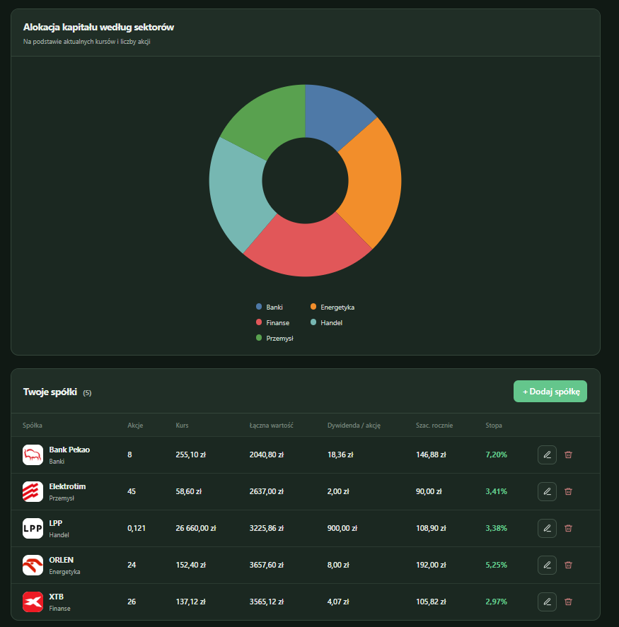
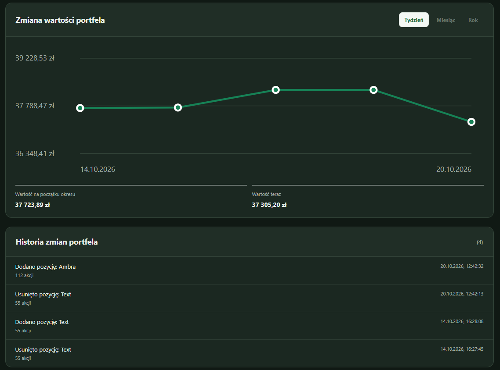

# Dividend Tracker

Prosty tracker portfela dywidendowego GPW. Aplikacja działa lokalnie w przeglądarce, a portfel i historia pozostają zapisane na tym urządzeniu.

<p align="center">
  
</p>

Aplikacja oferuje przejrzysty interfejs, około 70 spółek GPW oraz popularne ETF-y. (Jeśli chcesz, abym dodał instrument, napisz do mnie lub zostaw feedback pod projektem).

## Wsparcie projektu

Dividend Tracker rozwijam hobbystycznie i udostępniam bezpłatnie. Jeśli aplikacja Ci się przydaje, możesz docenić moją pracę stawiając mi kawę (albo białego dzika).

<p align="center">
  <a href="https://buycoffee.to/pacias1337">
    
  </a>
</p>

## Funkcje

- **Szacowana dywidenda roczna** netto na IKE (bez podatku Belki) oraz kwota zaoszczędzona na podatku
- **Wartość portfela** i średnia stopa dywidendy liczone z aktualnych kursów
- **Alokacja kapitału według sektorów** na wykresie kołowym
- **Lista Twoich spółek**: liczba akcji, kurs, łączna wartość, dywidenda na akcję, szacowana dywidenda roczna i stopa dywidendy
- **Statystyki i analiza** w jednej zakładce: historia portfela, dziennik wpłat, inflacja i roczny zwrot XIRR uwzględniający daty wpłat
- **Samouczek** prowadzący po głównych funkcjach aplikacji
- **Tryb jasny i ciemny**
- **Kopia zapasowa** portfela do pliku JSON i import na innym urządzeniu
- **Przypomnienie o kopii zapasowej** po 30 dniach bez eksportu
- **Prywatność**: portfel zostaje w Twojej przeglądarce i nie jest wysyłany na serwer

### Dywidendy ETF-ów

Historia zdarzeń dywidendowych Yahoo Finance za ostatnie 5 lat (sprawdzona 22 października 2026 r.) nie zawiera wypłat dla EUNL.DE, IS3N.DE, SXR8.DE, SXRV.DE, PPFB.DE, VWCE.DE, IUSQ.DE ani ETFBM40TR.WA, ETFBS80TR.WA i ETFBW20TR.WA. VGWD.DE zawiera zdarzenia wypłat. Brak zdarzeń w Yahoo nie gwarantuje polityki na przyszłość; aplikacja pokazuje te pozycje jako niewypłacające dywidendy na podstawie historii i dokumentów emitentów. Źródła Yahoo Finance: [EUNL.DE](https://finance.yahoo.com/quote/EUNL.DE/history/), [IS3N.DE](https://finance.yahoo.com/quote/IS3N.DE/history/), [SXR8.DE](https://finance.yahoo.com/quote/SXR8.DE/history/), [VGWD.DE](https://finance.yahoo.com/quote/VGWD.DE/history/), [SXRV.DE](https://finance.yahoo.com/quote/SXRV.DE/history/), [PPFB.DE](https://finance.yahoo.com/quote/PPFB.DE/history/), [VWCE.DE](https://finance.yahoo.com/quote/VWCE.DE/history/), [IUSQ.DE](https://finance.yahoo.com/quote/IUSQ.DE/history/), [ETFBM40TR.WA](https://finance.yahoo.com/quote/ETFBM40TR.WA/history/), [ETFBS80TR.WA](https://finance.yahoo.com/quote/ETFBS80TR.WA/history/), [ETFBW20TR.WA](https://finance.yahoo.com/quote/ETFBW20TR.WA/history/). Dokumenty emitentów: [iShares MSCI World](https://www.ishares.com/de/privatanleger/de/produkte/251882/ishares-msci-world-ucits-etf-acc-fund), [iShares EIMI](https://www.ishares.com/uk/professional/en/literature/fact-sheet/eimi-ishares-core-msci-em-imi-ucits-etf-fund-fact-sheet-en-gb.pdf), [iShares S&P 500](https://www.ishares.com/de/privatanleger/de/literature/fact-sheet/cspx-ishares-core-s-p-500-ucits-etf-fund-fact-sheet-en-de.pdf), [iShares NASDAQ 100](https://www.blackrock.com/uk/individual/products/253741/ishares-nasdaq-100-ucits-etf_1), [iShares ACWI](https://www.ishares.com/uk/professional/en/literature/kiid/ucits_kiid-ishares-msci-acwi-ucits-etf-usd-acc-gb-ie00b6r52259-en.pdf), [iShares Physical Gold ETC](https://www.ishares.com/de/privatanleger/de/literature/fact-sheet/sgln-ishares-physical-gold-etc-fund-fact-sheet-en-de.pdf), [Vanguard VWCE](https://global.vanguard.com/de-de/investment-products/etf/equities/9679/ftse-all-world-ucits-etf-usd-accumulating), [Vanguard VGWD](https://global.vanguard.com/de-de/investment-products/etf/equities/9506/ftse-all-world-high-dividend-yield-ucits) oraz [BETA ETF](https://betaetf.pl/en/our-funds).

## Zrzuty ekranu

### Portfel

Podsumowanie, alokacja sektorów i lista spółek w jednym widoku.

<p align="center">
  
</p>

### Statystyki i analiza

Jedna zakładka łączy zmianę wartości portfela, historię zmian, dziennik wpłat i analizę inflacji.

<p align="center">
  
</p>

## Wymagania

- Uruchomienie aplikacji: Node.js 18 lub nowszy
- Połączenie z internetem do pobierania notowań i danych o dywidendach
- Budowa stylów: Node.js 20 lub nowszy oraz pnpm 11.25

## Uruchomienie

1. Sklonuj repozytorium:
   ```sh
   git clone https://github.com/Pacias1337/Dividend-Tracker.git
   ```
2. Przejdź do katalogu:
   ```sh
   cd Dividend-Tracker
   ```
3. Uruchom serwer:
   ```sh
   npm start
   ```
   Alternatywnie:
   ```sh
   node server.js
   ```
4. Otwórz w przeglądarce [http://127.0.0.1:4173](http://127.0.0.1:4173).

Zatrzymaj serwer skrótem `Ctrl+C`. Jeśli port 4173 jest zajęty, ustaw zmienną środowiskową `PORT` przed uruchomieniem.

## Testy

```sh
npm test
```

## Edycja stylów

Style źródłowe znajdują się w `src/styles.css`. Aplikacja używa Tailwind CSS 4; skompilowany `app.css` jest częścią repozytorium, więc do samego uruchomienia nie trzeba instalować zależności. Do przebudowania stylów potrzebne są Node.js 20+ i pnpm 11.25:

```sh
pnpm install --frozen-lockfile
pnpm run build
```

## Dane i notowania

Portfel nie jest wysyłany na serwer. Aby przenieść go na inny komputer, zapisz kopię JSON w ustawieniach aplikacji i zaimportuj ją na drugim urządzeniu.

Kursy akcji są pobierane z Yahoo Finance. Kwoty dywidend pochodzą z publicznych uchwał WZA udostępnianych przez Agent Rynku; jeśli nie ma zatwierdzonej uchwały z bieżącego roku, aplikacja sprawdza ostatnią uchwaloną wypłatę, a następnie historię dywidend Yahoo Finance. Odpowiedzi są buforowane lokalnie przez serwer do sześciu godzin, a błędy źródeł przez pięć minut. Notowania mają 30-sekundowy cache; po chwilowej awarii serwer zwraca ostatnią dobrą cenę z oznaczeniem, że jest nieaktualna. Aplikacja pobiera kursy pozycji z portfela i cały katalog po otwarciu wyboru instrumentu.

Brak danych w źródle nie oznacza, że spółka nie wypłaca dywidendy. Yahoo Finance może udostępniać opóźnione notowania lub czasowo nie zwracać części kursów; aplikacja nie gwarantuje danych w czasie rzeczywistym.
