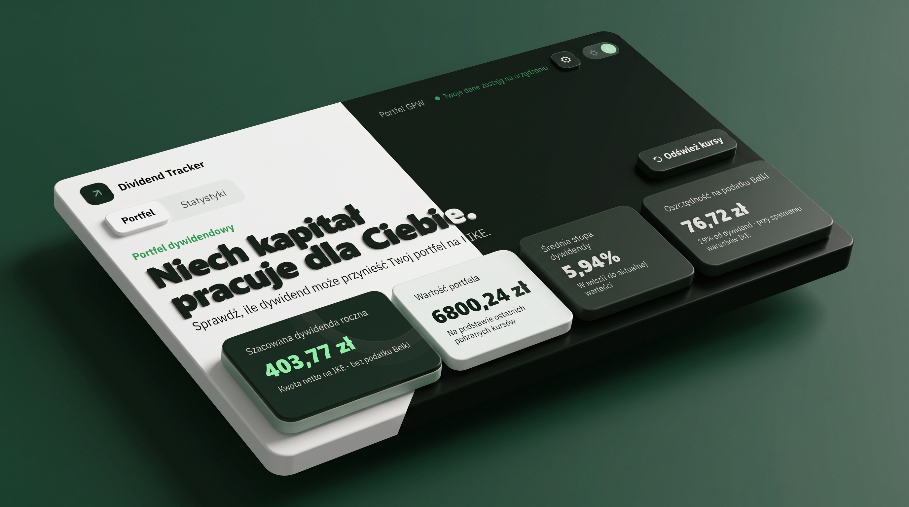

# Dividend Tracker

Prosty tracker portfela dywidendowego GPW. Aplikacja działa lokalnie w przeglądarce, a portfel i historia pozostają zapisane na tym urządzeniu.

<p align="center">
  
</p>

Aplikacja oferuje przejrzysty interfejs, statystyki oraz 70 spółek dywidendowych. Jeśli chcesz, abym dodał jakąś spółkę, napisz do mnie lub zostaw feedback pod projektem.

## Funkcje

- **Szacowana dywidenda roczna** netto na IKE (bez podatku Belki) oraz kwota zaoszczędzona na podatku
- **Wartość portfela** i średnia stopa dywidendy liczone z aktualnych kursów
- **Alokacja kapitału według sektorów** na wykresie kołowym
- **Lista Twoich spółek**: liczba akcji, kurs, łączna wartość, dywidenda na akcję, szacowana dywidenda roczna i stopa dywidendy
- **Statystyki**: zmiana wartości portfela w czasie oraz historia zmian
- **Tryb jasny i ciemny**
- **Kopia zapasowa** portfela do pliku JSON i import na innym urządzeniu
- **Prywatność**: portfel zostaje w Twojej przeglądarce i nie jest wysyłany na serwer

## Zrzuty ekranu

### Portfel

Podsumowanie, alokacja sektorów i lista spółek w jednym widoku.

<p align="center">
  
</p>

### Statystyki

Zmiana wartości portfela w czasie i historia zmian.

<p align="center">
  
</p>

### Tryb jasny i ciemny

| Jasny | Ciemny |
| --- | --- |
|  |  |

## Wymagania

- Node.js 18 lub nowszy
- Połączenie z internetem do pobierania notowań i danych o dywidendach

## Uruchomienie

1. Sklonuj repozytorium:
   ```sh
   git clone https://github.com/Pacias1337/Dividend-Tracker.git
   ```
2. Przejdź do katalogu:
   ```sh
   cd Dividend-Tracker
   ```
3. Uruchom serwer:
   ```sh
   npm start
   ```
   Alternatywnie:
   ```sh
   node server.js
   ```
4. Otwórz w przeglądarce [http://127.0.0.1:4173](http://127.0.0.1:4173).

Zatrzymaj serwer skrótem `Ctrl+C`. Jeśli port 4173 jest zajęty, ustaw zmienną środowiskową `PORT` przed uruchomieniem.

## Testy

```sh
npm test
```

## Edycja stylów

Style źródłowe znajdują się w `src/styles.css`. Aplikacja używa Tailwind CSS 4; skompilowany `app.css` jest częścią repozytorium, więc do samego uruchomienia nie trzeba instalować zależności. Do przebudowania stylów potrzebne są Node.js 20+ i pnpm 11.25:

```sh
pnpm install --frozen-lockfile
pnpm run build
```

## Dane i notowania

Portfel nie jest wysyłany na serwer. Aby przenieść go na inny komputer, zapisz kopię JSON w ustawieniach aplikacji i zaimportuj ją na drugim urządzeniu.

Kursy akcji są pobierane z Yahoo Finance. Kwoty dywidend pochodzą z publicznych uchwał WZA udostępnianych przez Agent Rynku; jeśli nie ma zatwierdzonej uchwały z bieżącego roku, aplikacja sprawdza ostatnią uchwaloną wypłatę, a następnie historię dywidend Yahoo Finance. Dane są buforowane lokalnie przez serwer przez maksymalnie sześć godzin.

Brak danych w źródle nie oznacza, że spółka nie wypłaca dywidendy. Yahoo Finance może udostępniać opóźnione notowania lub czasowo nie zwracać części kursów; aplikacja nie gwarantuje danych w czasie rzeczywistym.
